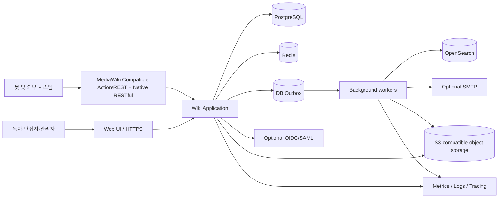
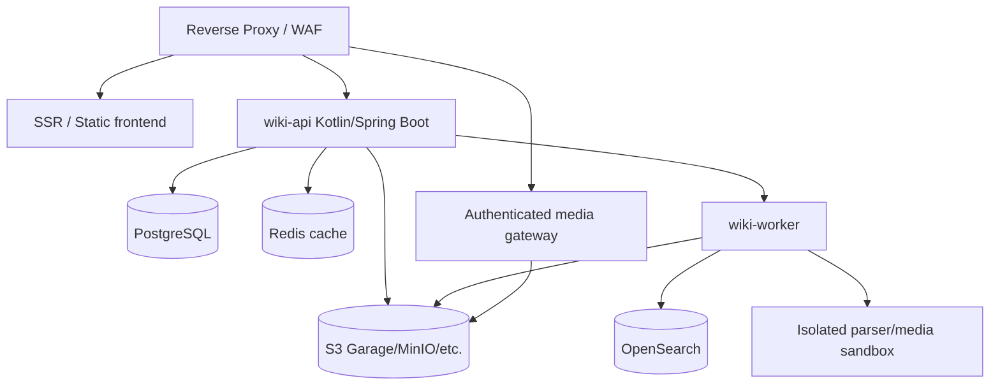
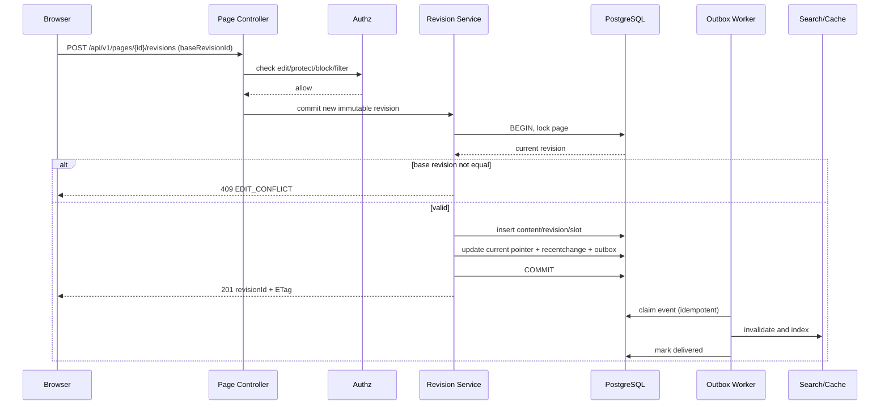
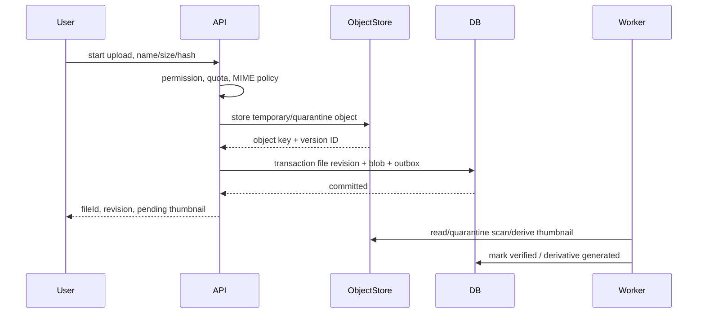
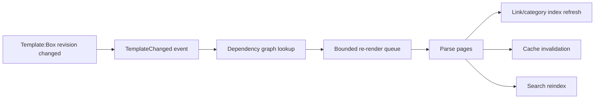
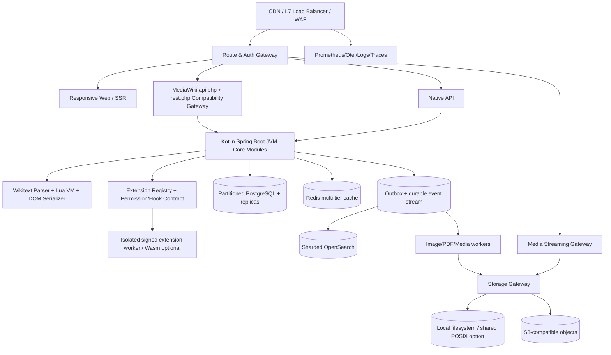
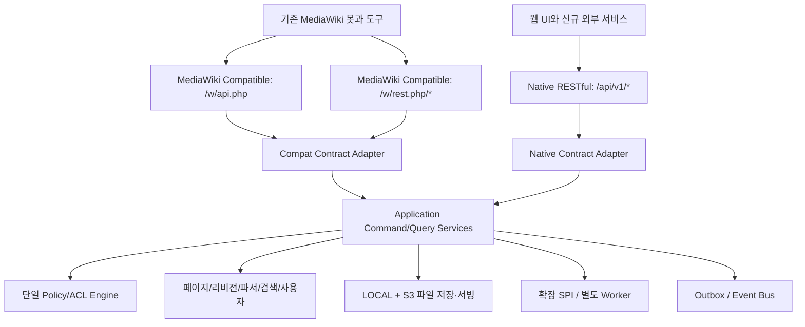

# 04. 기술 아키텍처 및 상세 설계서 (HLD/LLD)

## 1. 구현 원칙과 아키텍처 선택

**결정: Kotlin + Spring Boot JVM 기반 모듈형 모놀리스(Modular Monolith)로 시작하고, 렌더링·검색색인·미디어 변환 등 부하/안전성 경계만 독립 워커로 분리합니다.** 이유는 페이지 수정 시 리비전, 권한, 최근 변경, Outbox, 관리 로그 간 원자적 정합성이 필요하기 때문입니다. 모듈마다 명시적인 Kotlin 인터페이스와 DB schema ownership을 사용하며, 다른 모듈 엔터티에 직접 접근하는 것은 제한합니다.

프런트는 TypeScript/React 기반 SPA+SSR 혼합 또는 BFF를 사용할 수 있으나, 문서 읽기의 검색 엔진 색인/캐시 친화성을 위해 서버 렌더 가능한 HTML 전달을 우선합니다. 시각 편집은 ProseMirror 계열 AST 기반 확장 편집기를 제안합니다. 이름공간/템플릿은 프런트에서 직접 해석하지 않고 서버의 파서 계약을 사용합니다.

### 1.1 컨텍스트 다이어그램



### 1.2 컨테이너·프로세스 구성



단일 노드 소규모 설치는 `app`, `worker`, PostgreSQL, Redis, S3 호환 저장소를 개별 컨테이너로 시작할 수 있습니다. 다중 노드 확장 시 app은 stateless, 공유 세션/캐시·오브젝트 저장소·DB primary를 사용합니다. 컨테이너 수와 성능 수치는 부하시험 후 결정합니다.

## 2. 백엔드 bounded contexts

| 모듈 | 주도 엔터티 | 노출 포트/서비스 | 비동기 이벤트 | 금지 사항 |
|---|---|---|---|---|
| SiteConfig | WikiSettings, Namespace | ConfigurationService, NamespaceResolver | SiteConfigChanged | 임의 런타임 코드 변경 |
| Identity | User, Role, Membership, Block | AuthzService, UserService | UserBlocked, RoleChanged | 도메인별 사용자 테이블 복제 |
| Page | Page, Title, Redirect, Protection | PageService, TitleService | PageCreated, PageMoved, PageDeleted | Revision 직접 변경 |
| Revision | Revision, Slot, ContentBlob | RevisionService, DiffService | RevisionCommitted | 기존 revision 수정 |
| Parser | WikitextAST, TemplateExpansion | ParseService, DependencyExtractor | RenderInvalidated | 무제한 템플릿 전개 |
| LinkGraph | Outlink, Backlink, Category | LinkGraphService | LinkIndexChanged | 페이지 본문의 진실 원본화 |
| File | FileAsset, FileRevision, Blob | FileService, ThumbnailService | FileUploaded | DB 미확정 객체 공개 |
| Discussion | TalkTopic, Subscription | TalkService | ReplyCreated | Talk와 편집 권한 검사 분리 |
| Activity | RecentChange, Watchlist, AuditLog | RecentChangeService | ActivityRecorded | 감사 이벤트 삭제 |
| Search | IndexDocument | SearchService | ReindexRequested | 인덱스를 유일한 저장소로 취급 |
| Notification | Notification, Delivery | NotificationService | NotificationCreated | 편집 성공을 메일 발송에 종속 |
| Extension | ExtensionManifest, Hook | ExtensionRegistry | ExtensionEnabled | 외부 플러그인의 임의 SQL |
| Migration | ImportJob, Mapping, Verification | ImportService | ImportCompleted | 출처 추적 없는 데이터 덮어쓰기 |

**서비스 분리 조건:** 개별 컨텍스트의 리소스 격리 수요/배포 속도가 명확히 발생하거나 장기 처리 워커가 핵심 요청을 방해할 때 독립 서비스로 전환합니다. 초기부터 전체 MSA로 분해하지 않습니다.

## 3. 핵심 시퀀스

### 3.1 문서 저장과 비동기 색인



**중요 결정:** 사용자에게 저장 성공을 반환하는 기준은 PostgreSQL 트랜잭션 커밋입니다. OpenSearch/캐시 장애가 사용자 저장 실패로 전파되어서는 안 됩니다. Outbox 이벤트는 at-least-once이므로 소비자는 eventId와 target revision ID를 기준으로 멱등이어야 합니다.

### 3.2 미디어 업로드



API는 실제 파일 저장·검증 상태를 `PENDING`, `AVAILABLE`, `QUARANTINED`, `FAILED`로 구분합니다. 위험한 파일은 검역을 통과하기 전 다운로드 가능 상태로 전환하지 않습니다. 메타/객체 불일치 탐지에는 전용 정합성 배치가 필요합니다.

### 3.3 파서 의존성 무효화



반복 사용 템플릿의 재파싱 폭발을 방지하기 위해 배치 분할, rate limit, 동시성 상한, 작업 병합, 진행률과 연기 가능 작업을 구현합니다.

## 4. 파서·편집기 상세 아키텍처

### 4.1 처리 파이프라인

`source Wikitext` → `Tokenizer` → `CST (원본 위치/서식 보존)` → `AST` → `Template expansion / ParserFunctions / Lua` → `Link & Category extractor` → `Sanitized HTML DOM` → `Cache + provenance`. VisualEditor는 편집 DOM을 생성하고 선택적 직렬화 기법으로 문서에 다시 적용합니다.

Wikitext에는 완전한 형식 문법만으로 정의하기 어려운 문맥 의존 사례가 있으므로, MediaWiki parser tests를 실제 의미상의 규격으로 사용합니다. 지원하지 않는 태그/확장 문법은 기본적으로 원본 보존용 opaque node로 처리하며 **조용히 삭제하지 않습니다**.

### 4.2 파서 플러그인 포트

```kotlin
interface WikiParser {
    fun parse(source: String, context: ParseContext): ParseResult
    fun render(ast: WikiAst, context: RenderContext): RenderedPage
    fun serialize(document: EditableDocument, original: String): SerializationResult
}

interface TemplateResolver {
    fun resolve(title: NormalizedTitle, revision: Long?): TemplateContent?
}

interface ParserFunction {
    val name: String
    fun evaluate(args: List<LazyArg>, budget: EvaluationBudget): WikiNode
}
```

호환성 계약에는 시계·타임존·언어·권한·사이트 설정·정규화 규칙·재귀 제한·원본 위치 및 parserVersion이 포함됩니다. 템플릿 결과 캐시는 `(template revision ID, parameters hash, parserVersion, siteConfigVersion)`를 키로 사용합니다.

### 4.3 파서의 안전 제한 (초기 제안)

- 템플릿 깊이 최대 40, 전체 전개 노드 최대 50,000, 파서 실행 최대 2초, 출력 HTML 최대 3MiB. 값은 대표 자료로 부하/호환성 시험 후 조정합니다.
- Lua 실행 시간 300ms/문서, 메모리 32MiB/호출, 표준 라이브러리 allowlist, 네트워크·파일·프로세스 금지.
- 렌더 결과는 허용 목록 HTML sanitizer와 CSP 적용. 인용/코드/수식 렌더 결과도 예외 없이 정화합니다.
- 비지원 wikitext 태그는 잘못된 HTML을 생성하는 대신 UI 경고·원본 보존을 선택합니다.

## 5. 확장(Plugin) 아키텍처

### 5.1 확장 메타데이터 예시

```yaml
id: example.citation
version: 1.0.0
engineApi: '>=1.0 <2.0'
permissions:
  - parser.registerTag
  - ui.registerSlot
providedCapabilities:
  - citation.render
hooks:
  - revision.committed
uiSlots:
  - editor.toolbar
migrations: []
```

**제안:** 신뢰된 서버 확장만 운영자가 승인/서명 후 설치하고, 퍼블릭 플러그인은 기본적으로 프로세스 격리 또는 사전에 허용된 기능 슬롯 안에서만 실행합니다. MediaWiki `extension.json`, PHP hooks, JavaScript `mw.*`가 그대로 실행되는 것으로 소개하지 않습니다. 기능 호환성과 내부 확장 ABI 호환은 별개입니다.

### 5.2 이벤트 규약

`EventEnvelope { eventId, type, schemaVersion, wikiId, actorId, entityType, entityId, revisionId?, occurredAt, traceId, payload }`. Outbox publisher는 순서 보장 범위를 `wikiId + entityId` 파티션 내로 제한하며, 외부 전달은 at-least-once 방식과 재시도·DLQ를 사용합니다.

## 6. 주요 ADR (Architecture Decision Records)

| ADR | 결정 | 근거 | 기각한 대안/유보 사항 |
|---|---|---|---|
| ADR-001 | 코어는 모듈형 모놀리스 | 리비전·권한·outbox 원자성 및 초기 비용 | 전체 MSA는 초기 결합 비용 큼 |
| ADR-002 | PostgreSQL을 진실 원본으로 | ACID·JSONB·PITR 지원 | MediaWiki 기존 SQL 스키마 직접 재현 불필요 |
| ADR-003 | S3-compatible Object Storage | 이미지·첨부 파일의 파일시스템 종속 탈피 | 단일 로컬 디스크만 의존하지 않음 |
| ADR-004 | 불변 리비전 + ContentBlob + Slot | MediaWiki MCR 대응/감사 추적 | 문서 현재 본문 덮어쓰기 거부 |
| ADR-005 | Parser AST + raw/CST 보존 | 편집 왕복 시 원문 손실 위험 완화 | HTML을 유일한 저장 형식으로 쓰지 않음 |
| ADR-006 | Native REST + 전체 Action/REST API Compatibility Gateway | 계약 분리와 패리티 구현 | 기준 1.46.2 코어+활성 번들 외부 API의 모든 표면이 GA 게이트 |
| ADR-007 | Outbox 기반 비동기 워커 | 검색/이미지/알림 장애 격리 | 분산 2PC 대신 at-least-once |
| ADR-008 | OpenSearch 파생색인 | 고급검색/재색인 용이 | 검색을 데이터 원본으로 사용 금지 |
| ADR-009 | 미디어 및 Lua sandbox | 제3자 입력 공격 표면 격리 | 서버 내부 임의 실행 금지 |
| ADR-010 | 초기 단일 Wiki instance + wiki_id 예약 | 개발 범위 집중, 추후 분리 가능 | 멀티테넌트 전제 복잡성 유보 |

## 7. 디렉터리·코드 구조 권장안

```text
repository/
  backend/
    application/         # bootstrap, HTTP, security, configuration
    modules/
      identity/
      page/
      revision/
      parser/
      file/
      linkgraph/
      search/
      discussion/
      notification/
      extension/
      migration/
    adapters/            # PostgreSQL, Redis, S3, OpenSearch, mail
  frontend/
    apps/web/
    packages/editor/
    packages/ui/
  worker/                # async handlers, parser/media sandbox clients
  compatibility/
    parser-fixtures/
    action-api-fixtures/
    mediawiki-import-fixtures/
  docs/
  infra/
    compose/
    manifests/
  specs/
    openapi.yaml
    schema.sql
```

## 8. 기술 검증 계획

1. MediaWiki 릴리스 버전이 고정된 테스트용 wiki와 테스트 데이터셋을 생성합니다.
2. ParserTests에서 일반 문법, 템플릿, ParserFunctions, 확장 태그의 예상 결과를 추출합니다.
3. 파서 결과 비교는 단순 HTML 문자열이 아니라 정규화 DOM + 링크 대상 + 분류 + 에러 비교로 수행합니다.
4. 시각 편집과 원본 편집을 교차 수행한 후 문서 의미 및 원문 보존 여부를 확인합니다.
5. 대용량 템플릿/이미지 변경 이벤트 후 큐 회복 시간, 재시도, 장애 격리를 측정합니다.

## 9. 주요 공식 근거

- MediaWiki MCR: https://www.mediawiki.org/wiki/Multi-Content_Revisions/Content_Meta-Data
- Parser tests/QA: https://www.mediawiki.org/wiki/Parsing/QA
- MediaWiki API: https://www.mediawiki.org/wiki/API
- MediaWiki 확장 시스템: https://www.mediawiki.org/wiki/Manual:Extensions


## 11. v1.0 아키텍처 변경: 완전 호환 게이트웨이·플러그인·다중 스토리지



**핵심 분리**: 기존 API의 JSON/XML/HTTP 의미론은 compatibility gateway에서 구현하고 내부 Native REST와 바인딩하지 않습니다. 파서/템플릿/Lua 엔진은 Core의 독립 bounded context입니다. 확장관리자는 manifest·hook·권한을 사용하고 스토리지 종류는 단일 StoragePort로 감쌉니다.

**플러그인 실행 모드**: TRUSTED_JVM(서명·운영자 승인·재시작/클래스로더 격리)과 ISOLATED_RPC(별도 프로세스+비밀키/권한 제한)를 구별합니다. Native Image에서 외부 JAR 런타임 hot-load는 기본 전략이 아니므로 API/파서 확장성은 JVM 또는 별도 RPC 호스트에서 제공합니다. 외부 PHP 확장은 로딩하지 않습니다.

## 12. 영어 위키백과급 scale-out 토폴로지

| 계층 | 확장·보호 기법 | 근거/주의 |
|---|---|---|
| 읽기 | CDN edge, immutable revision cache, HTML parser cache, hot-key coalescing | 템플릿 무효화 및 권한 태그가 캐시키에 포함돼야 함 |
| 애플리케이션 | stateless JVM replicas, leaderless API, bounded concurrency, rate limits | 세션·토큰·정책 버전은 공유 저장소에서 검증 |
| 쓰기 | page ID 기반 동시성 보장, DB commit + outbox, 우선순위 queue | 가장 뜨거운 한 페이지의 직렬화는 별도 정책으로 통제 |
| 메타 DB | time/ID partition, replica, index/retention, hot/cold range 분리, online schema migration | 단일 PostgreSQL 인스턴스만으로 20억 revision 성능 보장하지 않음 |
| 파서 | bounded template expansion/Lua limits, worker isolation, per-page dependency graph, cascade invalidation | 악성 템플릿·mass invalidation 대응 필수 |
| 검색 | namespace/site shard, replica, incremental index + repair, Reindex alias rollover | 검색 장애가 편집 성공을 막지 않게 함 |
| 미디어 | CDN+private gateway, range streaming, derivative queue, local/S3 pluggable backend | 비공개 캐시 유출 방지 |
| 지표 | p95/p99, cache hit, DB replica lag, outbox backlog, parse cpu, extension cpu, S3 errors | ENWIKI 프로파일 종료 조건과 직접 연결 |

Wikipedia는 한 서버 수준이 아니라 분산 DB·캐시·검색·미디어 서빙·네트워크 운영의 **전체 시스템 규모**입니다. 설계 완료와 성능 입증은 별개이며, 실제 ENWIKI 수준 달성 표시는 부하시험 결과에 의해서만 허용합니다.

## 13. v1.0 핵심 ADR

| ID | 결정 | 사유 | 배제/대안 |
|---|---|---|---|
| ADR-101 | JVM Spring Boot를 주력 실행 환경으로 선택 | reflection/DI/운영 도구·확장 로딩·팀 생산성 | 전체 앱 Native AOT는 후순위 |
| ADR-102 | 미디어 LOCAL/S3 StoragePort 이중 구현 | 단일노드와 고가용성 환경 동시 지원 | FS 직접 노출 또는 S3-only 금지 |
| ADR-103 | 기존 Action/REST API 게이트웨이 분리 | 미세한 호환성 차이를 내부 도메인과 분리 | 일부 API만 우회 구현 금지 |
| ADR-104 | parser + Lua sandbox + DOM serializer 독립 모듈 | Wikitext 정밀 호환·리소스 제한 | regex 치환 위주의 간이 구현 금지 |
| ADR-105 | 확장은 manifest + capability + hook/SPI + isolated RPC | 독립 코드·보안·수명주기 관리 | MediaWiki PHP extension runtime 도입 금지 |
| ADR-106 | AGPL-3.0-only clean-room 독립 개발 | 사용자의 라이선스·코드 재사용 금지 의사 | upstream MediaWiki/Parsoid 코드 포팅 금지 |

## 14. v1.1 — 공통 도메인과 두 공개 API 계열



`Compat Contract Adapter`는 기존 MediaWiki의 `paraminfo`, XML/JSON, `continue`, token, 오류 코드, API 버전/활성화 확장별 형식을 책임집니다. `Native Contract Adapter`는 HTTP verbs, RESTful resource paths, OpenAPI, schema-based validation, OAuth/token과 `Problem Details`에 준하는 오류를 책임집니다. `Application Services`가 ID·권한·업무 규칙·트랜잭션·저장 실패 처리를 일관되게 보장합니다.

### API 구현 구조

- `api:compat-action`, `api:compat-rest`, `api:native-rest`는 **3개 구현 어댑터**이지만 외부에 제공하는 API **계열은 2종**입니다.
- `domain:page`, `domain:revision`, `domain:media`, `domain:auth`, `domain:parser`는 HTTP DTO에 의존하지 않습니다.
- `compat:profiles`와 `api:registry`는 `MediaWiki release → 기능 ↔ Compat route ↔ Native REST route ↔ tests`를 저장합니다.
- 같은 데이터 읽기 결과라도 API별 포맷/헤더/오류는 달라질 수 있습니다. 도메인 상태·인가·감사·보안은 달라지면 안 됩니다.
- 릴리스 게이트는 원본에 신규 MediaWiki API가 추가될 때 Native API 제공을 자동 누락 검사합니다.
