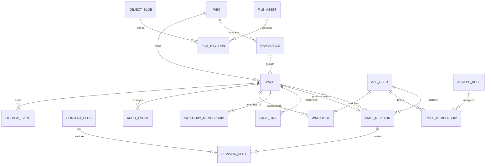

# 05. 데이터 모델 및 저장소 설계

## 1. 논리 데이터 모델

기존 MediaWiki의 page/revision/slots/content 구조를 참고하되 그대로 재사용하지 않습니다. 신규 시스템은 **불변 revision + 현재 리비전 포인터 + 독립 파일 리비전**을 갖습니다. 모든 파생 색인은 원본 리비전으로부터 재생성 가능해야 합니다.

## 2. 엔터티 사전

| 엔터티 | 주키 | 핵심 속성 및 업무 규칙 |
|---|---|---|
| Wiki | wiki_id | 사이트 단위 설정·기본 언어·공개 범위 |
| Namespace | (wiki_id, ns_id) | 이름/별칭/토론 대응/하위 문서·검색 정책 |
| Page | page_id | wiki_id, ns_id, normalized_title, current_revision_id, state, redirect_target; 제목 고유 |
| PageRevision | revision_id | page_id, parent_revision_id, author_actor_id, summary, timestamp, visibility, sha256 |
| RevisionSlot | (revision_id, role) | content_id, content_model; 최소 main 슬롯 |
| ContentBlob | content_id | immutable source, sha256, size, encoding, storage format |
| PageLink | (from_page_id, link_type, to_key) | 링크·템플릿·이미지 참조; 재생성 가능 |
| CategoryMembership | (page_id, category_page_id) | 카테고리 멤버십; 재생성 가능 |
| AppUser | user_id | username, status, locale, credential reference |
| RoleMembership | (user_id, role_id) | 부여자·시작·만료·사유 |
| Block | block_id | 대상 계정/IP 범위, 기간, 편집·계정 제한 플래그 |
| Protection | protection_id | page_id, action, required_permission, expiry |
| FileAsset | file_id | file namespace 제목, current_file_revision, visibility |
| FileRevision | file_revision_id | object_blob_id, uploader, sha256, size, MIME, state |
| ObjectBlob | object_blob_id | bucket, key, version, sha256, checksum, encryption metadata |
| Watchlist | (user_id, page_id) | watch expiry, notify settings |
| TalkTopic | topic_id | talk page, anchor/thread metadata, subscription |
| RecentChange | rc_id | revision/log event link, actor, tag, timestamp |
| Notification | notification_id | type, recipient, object, readAt, delivery channels |
| AuditEvent | event_id | actor, target, action, reason, redaction class, result; append-only |
| OutboxEvent | event_id | event type, partition key, schema version, payload, retry state |
| ImportJob | job_id | source hash, cursor, mapping version, result and verification |

## 3. 핵심 제약과 트랜잭션

- `UNIQUE(wiki_id, namespace_id, normalized_title)`는 활성/삭제 문서 정책까지 고려하여 정의합니다. 제목을 재사용할 때 tombstone/alias 관계는 별도 테이블로 관리합니다.
- Page.current_revision_id는 별도 FK뿐 아니라 참조 대상이 같은 페이지인지를 애플리케이션 트랜잭션 또는 DB trigger로 검증합니다.
- ContentBlob은 동일 해시 본문의 deduplication을 허용하되 privacy/tenant 경계를 넘는 참조 최적화는 기본 비활성화합니다.
- Revision 저장은 Page row lock 또는 compare-and-swap 방식으로 직렬화하여 lost update를 방지합니다.
- PageMove는 제목 인덱스·redirect·토론 이동·검색 이벤트를 하나의 업무 트랜잭션으로 관리합니다. 대량 링크 재인덱싱은 별도 큐입니다.
- File 업로드는 S3와 SQL이 공통 트랜잭션을 구성하지 못하므로 temporary object→metadata commit→finalize 상태기계, 보상 작업으로 처리합니다.
- 감사 이벤트는 관리 UI에서 삭제할 수 없으며 법적 삭제에 필요한 별도 보존/익명화 절차만 허용합니다.

## 4. 데이터 저장 분리

| 저장소 | 저장 대상 | 백업/복구 수준 | 진실 원본 여부 |
|---|---|---|---|
| 선택 DBMS (MariaDB/PostgreSQL/SQL Server/Oracle) | 사용자/문서/리비전/파일 메타/권한/감사/Outbox | DB별 일관 스냅샷·로그 복구·객체 교차 검증 | 예 |
| S3 호환 저장소 | 파일 원본, 과거 파일 revision, 파생 미디어 | Object versioning + 복제 + inventory/hash | 예(바이너리) |
| Redis | 세션·캐시·rate limit 단기 상태 | 필요 시 persistence, 소실 허용 범위 정의 | 아니오 |
| OpenSearch | 검색 인덱스 | 재색인 가능, snapshot은 복구 속도 목적 | 아니오 |
| Outbox/Worker | 비동기 상태·DLQ | DB 트랜잭션에 포함 | 이벤트 전달용 |

## 5. MediaWiki 데이터 이관 매핑

| MediaWiki 원본 | 신규 모델 | 검증 및 주의 |
|---|---|---|
| `page` | Page | namespace + title 정규화, redirect |
| `revision` + actor/comment | PageRevision | 원 작성자 및 timestamp, 숨김 비트, parent chain |
| `slots` + `content` + `text` | RevisionSlot + ContentBlob | MCR content model/format, 외부 blob 위치 |
| `image` | FileAsset + current FileRevision | 크기/MIME/SHA1/메타 원본 보존 |
| `oldimage` | 과거 FileRevision | 버전 순서·원본 바이너리 해시 확인 |
| `filearchive` | Deleted file archive | 삭제 파일 복구, 접근 제어 |
| `categorylinks` | CategoryMembership | 원본 링크로부터 재생성하고 표본 대조 |
| `pagelinks` / `templatelinks` | PageLink / Dependency | 동명 제목/이름공간 충돌 검사 |
| `logging` | AuditEvent | 접근권한 및 민감 로그 매핑 |
| `recentchanges` | RecentChange | 원본 운영 목적/보존 정책 고려 |
| `user` 및 권한 계열 | AppUser / RoleMembership | 계정명·기여·권한 연결 보존; 비밀번호 재설정, 이메일 불가 시 관리자 소유권 확인. 암호 해시 직접 이전 금지 |

원본 위키 데이터를 가져올 때 **원본 page/revision ID를 신규 ID와 동일하게 가정하지 않으며 기존 외부 숫자 ID가 같은 대상을 가리키도록 `legacy_id_map`을 유지**합니다. 출처 위키 ID, 이전 시각, 원본 SHA1/신규 SHA256, 변환 오류를 추적합니다. XML export가 모든 사용자/기록/첨부/삭제 이력을 포함한다는 가정도 금지합니다. 원본 SQL/파일 덤프가 있는 경우 read-only 추출과 API 확인을 병행합니다.

## 6. 이관 단계별 무결성 검사

1. 원본 inventory: 페이지 수, rev 수, 파일 수, 삭제 파일, namespace, 사용자, 링크, 카테고리, 템플릿 의존도를 집계합니다.
2. 원본 경로·metadata를 바꾸지 않은 raw snapshot을 별도로 보관합니다.
3. 샘플 1~5% 이관과 parser/visual snapshot 검증을 수행합니다.
4. 배치 이관은 업로드 멱등키 `(sourceWiki, sourceId, sourceVersion)`를 사용합니다.
5. Delta 수집·Freeze 및 Cutover 시점을 정하여 쓰기 유실을 방지합니다. 실제 이전 승인은 제품 출시와 분리하고 최대 24시간 편집·업로드 동결, 읽기 유지, 기존 URL·퍼머링크·ID 연결 보존을 리허설합니다.
6. 파일 해시는 실제 S3 다운로드·SHA256 재검증 후만 성공으로 판정합니다.
7. 결과 리포트는 변환 성공, 원본 누락, 파서 차이, 권한·삭제 이력 손실, 불명확 metadata를 구분합니다.

## 7. 스키마 설계 한계

첨부 `specs/schema.sql`은 **PostgreSQL 전용 역사적 예시 DDL**이며 ADR-0201의 네 DBMS 스키마를 구현한 것이 아닙니다. 공통 의미 계약은 아래의 DB 이식성 절을 따릅니다. 실제 구현 전 bigint/UUID 정책, 다중 위키, 파티셔닝, FK 삭제 규칙, 국제화 collation 및 동시성 정책 확정이 필요합니다. 제공된 예제만 적용하면 제품이 작동하는 것으로 간주해서는 안 됩니다.

## 8. 근거

- MCR: https://www.mediawiki.org/wiki/Multi-Content_Revisions/Content_Meta-Data
- Revision table: https://www.mediawiki.org/wiki/Manual:Revision_table
- Image administration: https://www.mediawiki.org/wiki/Manual:Image_administration

## 9. v1.0 대규모·정밀 호환 데이터 원칙

- 외부 호환 계층은 MediaWiki에 맞는 숫자형 `pageid`, `revid`, log ID 및 사용자 ID를 **영구적으로 안정되게** 발급합니다. 내부 UUID를 그대로 기존 API로 반환해서는 안 됩니다. 기존 위키 이관 시 충돌 없는 ID 매핑 및 다중 위키 분리 키를 저장합니다.
- `revision`은 절대 덮어쓰지 않으며 복원·이동·숨김·삭제·언어 변환 전후에도 이력과 slot/content model 관계를 유지합니다. 작성자 삭제/익명화는 정책에 따른 별도 가시성 필드로 처리합니다.
- 20억 revision 설계에서는 전체 테이블 partition 및 foreign key 적용 가능성, index cost, query planner, tombstone, cold archiving, dump streaming을 실제 데이터로 검증합니다. 단순 파티셔닝으로 모든 쿼리가 빨라진다고 가정하지 않습니다.
- `file_object`는 `(wiki_id, file_id, file_version, derivative_key, backend_id, object_key, hash)`를 매핑합니다. 해시/크기/검증 일시와 `PENDING→AVAILABLE→RETIRED` 전이를 기록하고, S3 ETag를 SHA-256으로 취급하지 않습니다.
- `file_storage_backend`는 LOCAL/S3 구성정보 ID를 가지되 비밀값은 외부 secret manager에 저장하며 DB에 접근키 원문을 쓰지 않습니다.
- `extension_installation`, `extension_migration`, `extension_permission_grant`, `extension_audit`는 사이트별 설치·승인·업데이트 이력과 서명을 기록합니다.
- 비공개 위키/CheckUser 정보를 검색 인덱스·로그·캐시에 원문 유출하지 않도록 읽기권한/보존기간의 일관된 data classification을 정의합니다.
- 모든 export/import에는 **공개 데이터와 비공개 데이터 별도 경로**를 제공하고 대용량 처리 중 페이지 단위 checkpoint와 검증 장부를 유지합니다.

## 10. 네 DBMS의 의미 보존과 복구 계약

- 타입 치환만으로 지원을 선언하지 않습니다. UUID/공개 숫자 ID, UTC와 시간 정밀도, 빈 문자열과 NULL, 본문/JSON·Unicode 왕복, 제목 고유성·정렬·색인 길이를 같은 도메인 결과로 검증합니다. DB 기본 collation에 제목의 의미적 동등성을 맡기지 않습니다.
- 지연 FK가 없는 환경도 같은 page/file revision 참조와 append-only를 보장하도록 삽입 순서·제약·트랜잭션을 설계합니다. DB별 DDL·잠금·CAS·deadlock 재시도·작업 lease·pending index·페이지네이션을 명시합니다.
- DDL 전체가 한 트랜잭션으로 롤백된다고 가정하지 않습니다. 코어·확장 migration은 각 DB에서 재개·보상·백업 복구를 포함해 시험합니다. 확장 schema/data는 플랫폼 persistence capability가 관리하고 임의 DB 접근이나 코어 schema 변경을 허용하지 않습니다.
- 네 DBMS × 두 LibertyWiki CPU × LOCAL/S3의 기능·ACL·동시성·장애·복구 결과를 검증합니다. 이 곱은 앱의 연결·기능 시험 범위이며 외부 인프라의 CPU/OS를 앱과 일치시키는 조건이 아닙니다.
- 확장을 비활성화·제거해도 원문·설정·저장 데이터를 보존하고, 영구 삭제는 별도 명시적 관리자 작업의 영향/감사/복구 계약으로 관리합니다.
- 이전 시 기존 세션·봇/API 토큰·OAuth 승인·MFA seed/복구 코드를 폐기합니다. 비밀번호 재설정·관리자 소유권 확인과 MFA 재등록 경로를 검증하며, 기존 기여 작성자 연결은 보존합니다.
- 원본 위키가 읽기 전용으로 확정되기 전의 증분과 대상 쓰기 개방 시점을 기록합니다. 대상 쓰기 이후 단순 원본 복귀로 새 데이터를 버릴 수 없습니다. 신규 변경 보존·복구/복귀 방법은 실제 이전 리허설의 미결 게이트이며 검증 전 전환 승인하지 않습니다.
