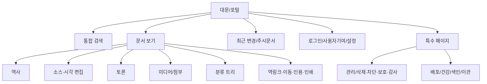

# 06. API·UI·권한 설계 — 공개 API 계열 2종

## 1. 구속력 있는 두 API 계열

| 계열 | 경로 | 계약·대상 | 새 기능·업데이트 규칙 |
|---|---|---|---|
| **MediaWiki Compatible** | `/w/api.php`, `/w/rest.php/*` | 기준 MediaWiki의 Action API 및 MediaWiki REST API의 외부 계약: path/params/forms/body/headers/auth/errors/format/continuation/side effect | 새 MediaWiki 버전에서 추가·변경된 API를 프로파일에 추가하고 원본 계약을 재현 |
| **Native RESTful** | `/api/v1/*` | 신규 플랫폼에 대해 정의한 resource-oriented REST: JSON/OpenAPI, 상태코드, JSON Schema, 독립 pagination/auth 정책 | **기준 버전과 향후 버전의 모든 도메인 기능 및 확장 기능에 별도 Native route 제공** |

`/w/rest.php`는 **MediaWiki Compatible 계열**입니다. `api.php`를 제외하면 된다는 의미가 아닙니다. `/api/v1`은 기존 MediaWiki REST API를 그대로 복제하는 계열이 아니라 새 계약입니다. `/w`는 프로파일의 scriptPath 예시이며 실제 이전에서는 기존 `/api.php` 등 원본 URL을 설정/라우팅으로 유지합니다. 원본 route와 설정은 실제 inventory로 검증합니다. **세 경로가 두 API 계열을 형성**합니다.

## 2. 정책과 동작 정의

1. 동일 기능의 Compat Action·Compat REST·Native REST 요청은 각기 별도의 변환 어댑터를 거쳐 **하나의 도메인 서비스**를 사용합니다.
2. 호환용 DTO 및 원본 오류 포맷은 변경을 금지하며, Native API의 DTO/오류/페이지네이션과 공유하지 않습니다.
3. 원본 MediaWiki에서 동일 기능이 Action/REST 중 하나에만 노출된 경우 **존재하는 원본 경로만 호환하고**, Native API는 반드시 제공합니다.
4. 원본의 API에는 없고 UI에만 존재하던 기능도 Native RESTful API에는 제공합니다. 다만 원본에서 존재하지 않은 경로는 억지로 MediaWiki Compatible로 만들어서 호환이라고 주장하지 않습니다.
5. 1.47 등 새 버전에서 새 API가 등장하면 해당 기능을 `capability_id`로 등록하고 **MediaWiki Compatible 경로 + Native RESTful 경로가 같은 릴리스에서 동시 제공**되어야 합니다. 빠진 쪽이 있으면 release gate 실패입니다.
6. 두 계열은 동일한 권한결정·비공개 마스킹·수정 충돌·문서/파일 이력·감사·캐시 무효화·이벤트 발행을 공유합니다.
7. MediaWiki Compatible의 기존 `api.php`/`rest.php` URL 패턴 및 등록된 version path는 변경하지 않습니다. Native major breaking change는 `/api/v2`를 추가하고 `/api/v1`의 지원기간을 공지합니다.

## 3. 주요 기능별 공개 API 대응 (대표 예시)

| 기능 ID | MediaWiki Compatible (예) | Native RESTful (안) | 공유 도메인 처리 |
|---|---|---|---|
| CAP-PAGE-READ | `GET /w/api.php?action=query&prop=revisions&titles=...`; `GET /w/rest.php/v1/page/{title}` | `GET /api/v1/pages/{id}` | PageQuery, visibility |
| CAP-PAGE-CREATE | `POST /w/api.php?action=edit` 및 제공되는 MediaWiki REST page creation | `POST /api/v1/pages` | PageCreateCommand, revision commit |
| CAP-REVISION-COMMIT | `POST /w/api.php?action=edit`; MediaWiki REST write route(기준 확인) | `POST /api/v1/pages/{id}/revisions` | RevisionCommit, optimistic lock |
| CAP-REVISION-HISTORY | `GET /w/api.php?action=query&prop=revisions`, `GET /w/rest.php/v1/page/{title}/history` | `GET /api/v1/pages/{pageId}/revisions` | PageApplicationService, 읽기 권한과 이력 페이지네이션 |
| CAP-REVISION-READ | `GET /w/api.php?action=query&prop=revisions&revids=...`, `GET /w/rest.php/v1/revision/{id}` | `GET /api/v1/revisions/{revisionId}` | PageApplicationService, 읽기 권한과 고정 revision 원문 |
| CAP-REVISION-COMPARE | `GET /w/api.php?action=compare&fromrev=...&torev=...`, `GET /w/rest.php/v1/revision/{from}/compare/{to}` | `GET /api/v1/revisions/{fromId}/compare/{toId}` | PageApplicationService, 같은 문서의 두 판과 공통 읽기 권한 |
| CAP-PAGE-MOVE | `POST /w/api.php?action=move` | `POST /api/v1/pages/{id}/moves` | PageMove, redirect/ACL |
| CAP-PAGE-PROTECT | `POST /w/api.php?action=protect` | `PUT /api/v1/pages/{id}/protection` | ProtectionPolicy, logs |
| CAP-PAGE-DELETE | `POST /w/api.php?action=delete` | `DELETE /api/v1/pages/{id}` | PageSoftDelete, audit |
| CAP-SEARCH | `GET /w/api.php?action=query&list=search` | `GET /api/v1/search?q=...` | SearchQuery, visibility |
| CAP-PARSE | `POST /w/api.php?action=parse` 또는 기준 REST parse 경로 | `POST /api/v1/parse` | WikitextParse, limits |
| CAP-FILE-UPLOAD | `POST /w/api.php?action=upload` | `POST /api/v1/files/uploads` | UploadSession, scan, publish |
| CAP-WATCH | `POST /w/api.php?action=watch` | `PUT /api/v1/watchlist/pages/{id}` | WatchService, notifications |
| CAP-EXT-ABUSEFILTER | 활성 확장에 등록된 기존 `action=...` | `/api/v1/extensions/abuse-filter/*` | Extension capability/permissions |

위 목록은 **대표 구조**이며 API 인벤토리 전체라는 주장이 아닙니다. 실제 MediaWiki 경로와 요청·응답·권한 조건은 버전별 수용시험으로 확정합니다. 자세한 계약은 `14_DUAL_API_CONTRACT.md`, 표준 매핑 파일은 `specs/api_operation_registry.csv`입니다.

## 4. API 정밀 호환 시험 축

| 항목 | MediaWiki Compatible | Native RESTful | Cross-surface 검증 |
|---|---|---|---|
| 경로·메서드 | 정해진 `api.php`/`rest.php` 및 메서드 유지 | `/api/v1` resource URL, OpenAPI | capability 매핑 100% |
| 반환 | format/formatversion, continue, warning, MW errors | JSON schema, HTTP status, cursor, error model | 동일 업무 결과 ID/revision |
| 인증 | 원본 세션, 토큰, bot 흐름의 외부 계약 | Bearer/OIDC/session 정책 | 동일 ACL·비공개·가시성 |
| 쓰기 | conflict, basetimestamp, maxlag, 토큰 | If-Match, Idempotency-Key | 동일 DB 상태/로그/이벤트 |
| 검색/파일 | 기존 쿼리 필터·multipart/stash | 검색 리소스, 업로드 세션 | 같은 검색 인가·오브젝트 해시 |
| 확장 | 기존 원본 API가 있을 때만 호환 | **모든 확장 공개 관리·업무 기능** | 동일 capability 및 sandbox |

## 5. API 플랫폼 운영

- 각 operation은 `featureId`, `sourceMediaWikiVersion`, `compatAction`, `compatRest`, `nativeRest`, `permissions`, `testIds`, `lifecycle`, `owner`를 메타데이터로 등록합니다.
- 기준 버전 설치 상태(활성 확장, 언어, 권한 구성)를 기록하고 Action `paraminfo` 및 REST route discovery 기반 블랙박스 시험을 수행합니다.
- 한 API의 사용량·지연·오류율·캐시·rate limit은 구분 관측하지만 도메인 데이터는 공유합니다.
- 웹 UI는 Native RESTful API 중심으로 구현하고, 기존 MediaWiki 봇과 스크립트는 Compatible API를 사용하도록 합니다.

## 5. UI 화면 정보구조(IA)

## 6. 상세 화면 목록

| UI ID | 화면·경로(제안) | 주 구성요소 | 중요한 상태 |
|---|---|---|---|
| UI-01 | `/wiki/{title}` | 제목/목차/본문/도구/참고문헌/분류/파일 | 없는 문서, redirect, 보호, 오류 |
| UI-02 | `/wiki/{title}?action=edit` | 편집 모드, 서식 툴바, 미리보기, 저장 전 차이, 변경 요약, 구성에 따른 편집기 내 파일 업로드·삽입 | 저장 전 차이 조회에서 상태 불변, 충돌과 파서 경고, 세션 만료 시 재로그인과 임시초안 보존 |
| UI-03 | `/wiki/{title}?action=history` | 이력 목록, 두 revision 선택, diff | 삭제·숨김 revision |
| UI-04 | `/wiki/{title}?action=info` | metadata, Page ID, 길이, revision, 링크 | 접근 제어 |
| UI-05 | `/wiki/{title}?action=purge` | 렌더 캐시 강제 초기화 | rate limit/권한 |
| UI-06 | `/special/search` | 검색어, namespace, 날짜/분류 필터 | 0건, 장애 폴백 |
| UI-07 | `/special/recentchanges` | 날짜/계정/봇/태그/순찰 필터 | 지연·숨김 기록 |
| UI-08 | `/special/watchlist` | 감시 문서 목록, 알림 상태 | 로그인 필요 |
| UI-09 | `/special/upload` | 업로드 영역, 정책, 중복 확인, 진행 상태 | 격리·검사 실패 |
| UI-10 | `/wiki/File:{name}` | 원본·썸네일·메타·이력·사용 문서 | 비공개·바이너리 누락 |
| UI-11 | `/wiki/Category:{name}` | 카테고리 목록·하위 트리 | 과다 노드·순환 |
| UI-12 | `/special/contributions/{user}` | 기여 목록·필터·diff·감사 | 숨김 revision |
| UI-13 | `/special/preferences` | 언어/편집기/알림/접근성, 스킨·색상 모드 선택, 기준 프로파일의 롤백 확인 설정 | 저장 유효성, 스킨과 색상 모드 개별 초기화 시 사이트 기본값 적용, 확인 취소 시 변경 없음 |
| UI-14 | `/special/admin/*` | 사용자 권한·차단·보호·삭제·복구, 사이트 기본 스킨·색상 모드 | 역할별 접근 거부, 개인 선택이 없는 항목에 기본값 적용 |
| UI-15 | `/special/ops/*` | 작업 상태·백업·색인·이관·오류 | 대량 작업/실패 복구 |

검색 수용시험은 제목, 일반 본문, 원문에만 존재하는 구문, 틀 전개로만 생성되는 문자열을 구분해 고정 호환 프로파일의 결과와 비교합니다. 색인·강조·결과 수·캐시에 현재 읽기 권한을 적용합니다. 문서 파일 렌더링은 표준 `class=`와 `link=`를 각각 사용한 사례와 함께 지정한 사례의 DOM·클릭 대상·빈 링크·편집 왕복을 비교합니다. 기준 설정에서 외부 이미지가 허용되는 경우에는 허용 도메인과 거부 도메인의 동작을 함께 검증합니다. 각 사례는 FR-SEARCH-001/003, FR-LINK-001, FR-COMP-003 및 [사용자 요구 출처](16_USER_REQUIREMENT_TRACEABILITY.md)에 연결합니다.

### 후속 공통 UI

- 관리 화면은 현재 설정 요약과 사용자 설정·사이트 설정·관리 작업을 연결합니다. 특수 페이지의 타일·목록과 권한 필터를 제공하며, 직접 URL과 모든 설정 변경에는 서버 인가를 적용합니다. FR-UX-001.
- 최근 변경은 행 안에서 읽을 수 있는 차이를 열고, 개인 설정에 따라 롤백 요청의 확인을 표시합니다. 기존 비교·롤백 서비스를 사용합니다. FR-UX-003/004.
- 원문 편집기에서 편집 중 표시, 미리보기·차이 탭, 로그인 복구, 이미지 업로드·삽입, 시각적 표 편집과 대체 입력을 제공합니다. 초안·요약·기준판을 모드 사이에서 공유하며 저장 시 현재 권한과 충돌을 검사합니다. FR-UX-002/005–009.

## 7. 화면 상호작용과 접근성

- 문서 링크는 존재·비존재 및 이름공간을 시각적으로 구분합니다.
- 편집 화면은 툴바 키보드 탐색, 탭 순서, 충돌 알림 초점 이동, 스크린리더 상태 발표를 지원합니다.
- 무단 접근 또는 숨김 revision에는 API·UI 모두 내용/제목/파일 URL 노출 정책을 적용합니다.
- 파서 에러는 원본 위치(line/column)와 오류 범주를 제시하고, 편집기에서 해당 구간으로 이동합니다.
- 모바일에서 목차/페이지 액션을 접거나 펼칠 수 있고, 수평 스크롤을 강요하지 않는 표 대체 UI를 제공합니다.

## 8. 역할·권한 기본 정책 (기본안, 변경 가능)

| 작업 | 익명 | 등록자 | 편집자 | 검토자 | 문서 관리자 | 권한 관리자 | 운영자 |
|---|---|---|---|---|---|---|---|
| 공개 문서 읽기 | O | O | O | O | O | O | O |
| 신규 문서 생성/편집 | 정책 | 정책 | O | O | O | 설정 | 설정 |
| 업로드 | - | 정책 | O | O | O | 설정 | 설정 |
| Undo | - | 정책 | O | O | O | 설정 | 설정 |
| Rollback/Patrol | - | - | - | O | O | 정책 | 정책 |
| 이동 | - | 정책 | O | O | O | 설정 | 설정 |
| 삭제/복원/보호 | - | - | - | - | O | 설정 | 정책 |
| 계정 차단 | - | - | - | - | O | O | 정책 |
| 권한 부여 | - | - | - | - | - | O | 정책 |
| 인프라·확장 운영 | - | - | - | - | - | - | O |
| 민감 CheckUser | - | - | - | - | - | - | 별도 검사관 권한 |

'O'는 제안 기본 허가, '정책/설정'은 인스턴스 설정으로 결정, '-'는 기본 거부입니다. 실제 인가는 페이지 보호/차단/소유권/토큰 scope 등의 조건을 합성합니다. 운영자 인프라 권한과 위키 콘텐츠 관리자 권한은 기본적으로 별개입니다.

## 9. API 참조

- MediaWiki API: https://www.mediawiki.org/wiki/API
- Action API: https://www.mediawiki.org/wiki/API:Action_API
- REST API: https://www.mediawiki.org/wiki/API:REST_API
