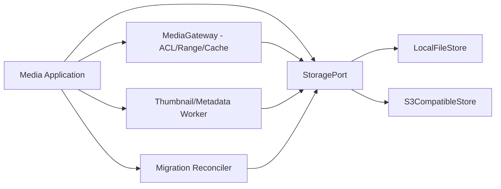

# 11. 로컬 파일·S3 호환 저장/서빙 설계

## 1. 핵심 요구

**파일 저장과 파일 HTTP 서빙 모두** `LOCAL`와 `S3_COMPATIBLE` 구현을 제품 기본 기능으로 제공합니다. MediaWiki AWS 확장 코드를 사용하지 않으며 자체 API/스토리지 계층입니다. 사이트별 기본 backend를 선택하고 전체 또는 단위 파일 전환을 지원합니다. 관리자가 공개/비공개 위키·이름공간·미디어 정책·업로드 허용 형식 및 크기를 제어합니다.

## 2. Port 설계

`StoragePort`: `put(tempKey, stream, length, digest)`, `promote(tempKey, immutableKey)`, `head`, `getRange`, `list`, `deleteVersion`, `verify`, `copy`, `exists`. 저장소별 API의 완전한 공통 교집합만 강요하지 않고 multipart, presign, conditional requests, backend capabilities를 선택적으로 기술합니다.

## 3. 업로드 상태 전이

`REQUESTED → STAGING → SCANNED → PUBLISHED → INDEXED` / `FAILED → RETRY / ABORTED`.

- **LOCAL**: 임시 디렉터리에 스트리밍 기록, 길이/해시 검증, MIME sniffing/악성 콘텐츠 검사, 확정 경로로 atomic rename(동일 filesystem 가정), 파일명 비신뢰 처리, 원본 공개 directory 직접 매핑 지양.
- **S3**: 임시 object key 또는 multipart upload → checksum 검증 → published immutable key 복사/참조 전환 → orphan cleanup. **S3는 일반 파일시스템의 atomic rename을 지원하지 않으므로**, DB manifest commit·object 상태 기계와 재시도로 정합성을 확보합니다.
- **공통**: 파일 원본/old version/derivative 모두 별도 보존, 크기·digest·MIME·owner·license·ACL·revision 연결, 보안 검사 실패 시 publish 금지, DB·object 불일치는 보정 작업이 복구합니다.

## 4. HTTP 서빙 및 접근통제

- 모든 공개 파일에 대하여 논리 filename/version/thumbnail path 매핑, `Content-Type`, `Content-Disposition`, `ETag`, `Last-Modified`, `If-None-Match`, `Cache-Control`, 206 Range, stream cancellation을 지원합니다.
- **LOCAL**: 애플리케이션 MediaGateway 또는 권한 확인 후 reverse-proxy offload(X-Accel-Redirect) 이용. private 파일 direct file server URL 금지.
- **S3**: private bucket default; MediaGateway stream proxy 또는 서버가 사전 인가 후 짧은 TTL presigned URL을 발행. 공개 CDN 경로는 정책에 따른 public asset에서만 허용합니다.
- 캐시 키에는 wiki, 파일 버전, visibility scope, transformer version을 포함하며, 비공개 파일은 공유 CDN 캐시 기본 비활성화합니다.
- MIME/content sniffing 정책과 SVG/PDF/HTML 실행 위험을 분리하고 원본 실행 가능한 콘텐츠 inline 서빙을 금지하거나 격리 도메인에서 제공합니다.

## 5. 로컬↔S3 이전

`DISCOVER → SNAPSHOT MANIFEST → COPY → VERIFY → DUAL-READ / CUTOVER → RETAIN → RETIRE` 작업 상태와 감사 로그를 제공합니다. 파일 revision ID 및 URL은 이전 중·이후 변하지 않아야 합니다. 이전 중 쓰기는 versioned placement manifest를 거쳐 분할 처리하며 source 삭제는 checksum 100% 확인과 보존기간 경과 후에만 허용합니다.

**장애 주입:** 디스크 가득 참, S3 5xx/429/일시 중단, multipart 실패, DNS 변경, 객체 삭제, network partition, 권한 변경, presign 만료, checksum mismatch, 경쟁 업로드, 갑작스러운 프로세스 종료.

## 6. 대규모 운영

미디어 원본은 CDN/프록시 계층을 통해 웹 API compute와 분리하고, 썸네일은 비동기 큐로 생성하며, S3 호환 엔진은 path-style/virtual-hosted style·multipart·Range·조건부 request를 **실제 통합 테스트**합니다. 'S3 compatible'이라는 표기는 모든 공급자 구현을 자동 보장하지 않습니다. 엔진별 지원 행렬을 유지해야 합니다.

## 7. 요구사항 매핑

`FR-MEDIA-*`, `FR-DUALAPI-008`, `FR-STORAGE-*`, `NFR-SEC-*`; API 매핑은 MediaWiki Compatible `action=upload` 및 파일 관련 조회, Native REST `/api/v1/files/*` 양계열에서 동일한 파일을 반환하는 것으로 검증합니다.
